# Bill Walsh College Football '95 Elevated

A mod for **Bill Walsh College Football '95** (Sega Genesis / Mega Drive, USA). It keeps the game's feel, fixes the original game's bugs, and adds the plays, controls and CPU smarts it was missing. The **2026 Season Edition** brings **all 138 FBS teams with 2026 rosters**, the 2026 conferences, and a full season mode with conference title games and the College Football Playoff.

- **Fixed fatigue system!** Every player tires from what he does on the field and recovers between plays. In the original game, ball carriers tired extremely quickly and barely recovered during a drive, so after one or two carries your best players were essentially unusable for the rest of the drive unless you called a timeout. This fix is why the mod was started, and on its own it drastically improves the game.
- **The original game's bugs, fixed:** the wrong team kicking off after a 2-point try turnover, pitches that land behind fast backs, and a season sim that reads offense and defense backwards.
- **More explosive plays:** ball carriers keep their speed longer on long runs and runs after the catch, so breakaway plays happen more often.
- **All 138 FBS teams** in the 2026 Season Edition, with 2026 rosters and conferences and a new season mode: random or real 2026 schedules, conference title games, and a 12-team College Football Playoff (or 24, 4, BCS 2 or none).
- **More plays and pre-snap control:** 67 plays added from College Football USA '97 (the original game has 96 offensive plays), two all-new plays (RPO and HB SWING), a Flip Play tile on the play-call screen (in place of Instant Replay), pre-snap motion, flipping plays at the line, and defensive alignment shifts.
- **6-button gamepad support:** true 5-receiver passing with the X and Y buttons, flips and shifts at the line, and pre-snap views of the play art, assignments and energy bars. With a 3-button gamepad the game plays as before.
- **A smarter CPU:** four difficulty levels, more and smarter CPU audibles, more aggressive 4th downs, smarter defenses, and more.
- **Quality-of-life improvements:** faster kickoff setups after scores, menu music on or off with X, and more.

This repository contains BPS patches only, no ROM. You need your own copy of the game.

 

## Contents

- [Why Bill Walsh '95?](#why-bill-walsh-95)
- [Which patch?](#which-patch)
- [Features](#features)
- [Controls](#controls)
- [How to patch](#how-to-patch)
- [Game Genie codes (fatigue only, no patching)](#game-genie-codes-fatigue-only-no-patching)
- [Original ROM required](#original-rom-required)
- [Patched ROMs](#patched-roms)
- [Changelog](#changelog)
- [Technical notes](#technical-notes)
- [Testing](#testing)
- [Credits](#credits)

## Why Bill Walsh '95?

In my opinion, Bill Walsh College Football '95 for the Sega Genesis has the greatest gameplay of any 16-bit football game. It has the fun physics and player models of Madden '94, and it introduced windowless passing for the first time in an EA Sports football game. Later games (Madden '95 and College Football USA '96) changed the player models and gameplay significantly and, in my opinion, aren't as fun to play. The biggest problem with BW95 was its broken fatigue system, which this mod fixes, along with the game's other bugs. It also adds the plays, controls, CPU smarts and teams the game was missing.

## Which patch?

| Patch | What you get |
|---|---|
| `Bill_Walsh_College_Football_95_Elevated_v2_0_0.bps` | **Elevated.** Every feature below, with the original 36 teams, their 1994 rosters and the original season mode. Title screen: ELEVATED. |
| `Bill_Walsh_College_Football_95_Elevated_2026_Season_v2_0_0.bps` | **Elevated: 2026 Season Edition.** Every feature below, plus all 138 FBS teams with 2026 rosters and conferences, and the new season mode. Title screen: ELEVATED, 2026 Season Ed. A 4 MB ROM with 32 KB of save RAM (see [Saves](#saves)). |
| `Bill_Walsh_College_Football_95_Fixed_Fatigue_Fixes_v2_0_0.bps` | The fatigue fix and fixes for the original game's bugs (2-point try kickoff, pitches to fast backs, season sim). No other gameplay changes. Original title screen. |
| `Bill_Walsh_College_Football_95_Fixed_Fatigue_v2_0_0.bps` | Only the fatigue fix. Original title screen. |
| `Bill_Walsh_College_Football_95_No_Fatigue_v2_0_0.bps` | Only one change: energy never drops. Original title screen. |

The patches are in the [`patches`](patches) folder. Both Elevated editions use Fixed Fatigue. Patches for older versions are attached to their [releases](https://github.com/jd6-37/Bill-Walsh-CFB-95-Elevated/releases).

## Features

### Original-game fixes

| Fix | Elevated editions | Fixed Fatigue + Fixes | Fixed Fatigue |
|---|:-:|:-:|:-:|
| [Fatigue](#fatigue) | ✓ | ✓ | ✓ |
| [Wrong team kicks off after a 2-point try turnover](#2-point-conversion-kickoff) | ✓ | ✓ | |
| [Pitches land behind fast backs](#pitches-to-fast-backs) | ✓ | ✓ | |
| [Season sim reads offense and defense backwards](#season-sim) | ✓ | ✓ | |

#### Fatigue

**Everyone tires, from what he does on the field.** In the original game a running back loses about 27% energy per carry and barely recovers during a drive; only a timeout brings players back. Now every player's energy drops with what he does while the play is live: the distance he runs, the time he's locked in a block, and hits. Everyone recovers a quarter of his fatigue at each snap, and timeouts and halftime still reset everyone to 100%.

#### 2-point conversion kickoff

In the original game, if the defense recovered a fumble on a conversion try, the team that got scored on had to kick off. Now the scoring team kicks off.

#### Pitches to fast backs

The game aims a pitch where the back will be if he keeps his speed. On the option the back is held to the QB's pace until the pitch and then speeds up, so a fast back ran past the ball and it landed behind him. Now the pitch is re-aimed in flight at where the back will be when it comes down, with the same flight time and arc. Fast backs are no longer a problem on the option and toss plays.

#### Season sim

When the original game simulated CPU-vs-CPU season games, it read each team's offense and defense ratings backwards, so a great defense scored points and a great offense kept the other team's score down. Fixed in the Elevated editions and Fixed Fatigue + Fixes.

### More explosive plays (Elevated)

In the original game a ball carrier starts losing speed right away and is down to lineman speed after a few seconds, so breakaway runs crawl after a few yards. Some slowdown is part of the game's design, but it's too much. The Elevated editions reduce it on long runs and runs after the catch, for human- and CPU-controlled teams, so explosive plays happen more often. The ball carrier keeps full speed for about the first 1.5 seconds, then slows down, faster the more tired he is:

| Energy (roster screen) | Slowdown after the first 1.5 s |
|---|---|
| 90% or higher | about 2/3 as fast as the original game |
| 75–89% | about 3/4 as fast as the original game |
| below 75% | same as the original game |

### 2026 Season Edition with all 138 FBS teams

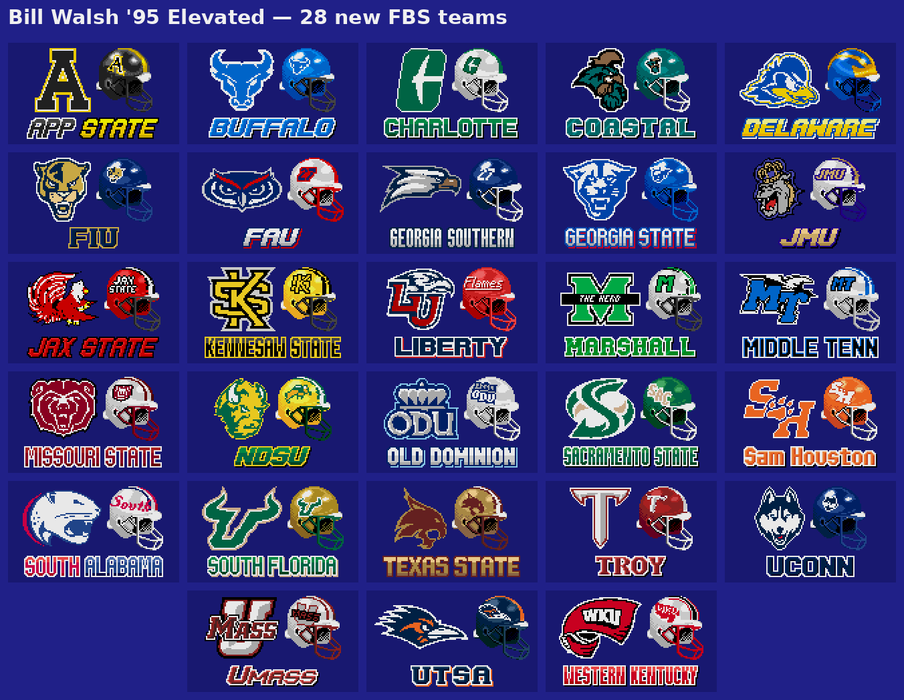

- **All 138 FBS teams of 2026:** the 110 teams from College Football USA '97, and 28 more with new helmets, logos, wordmarks and uniforms made for this mod (above). On Game Setup the teams are in alphabetical order; hold left or right to scroll fast.
- **2026 conferences:** SEC (16 teams), Big Ten (18), ACC (17), Big 12 (16), American (14), Sun Belt (14), MAC (13), Mountain West (10), Conference USA (10), Pac-12 (8) and the Independents (Notre Dame, UConn).

  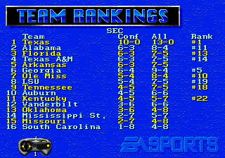

- **2026 rosters**, converted from EA Sports College Football 27's player ratings (Week 9 update), and CPU offense and defense styles that follow each team's 2026 scheme.
- **Team ratings from the 2026 rosters:** OFF/DEF ratings on Game Setup and Team Schedules, also used by the season sim.
- **Walsh Reports for all 138 teams**, written for 2026. Each offense and defense scouting report names the key players with their jersey numbers (the rosters have no names).
- **New title art:** Malachi Toney of Miami replaces Bill Walsh's portrait.
- **Pause menu:** Timeout has moved up to right below Resume Game, and it now shows how many you have left ("Timeout - 2 left").
- **Jersey numbers** under the players show single digits without a leading zero.

#### Season mode

- **Game Setup**, Play Mode *New Season*:
  - **Schedule:** *Random* (12 weeks: each conference's games plus random non-conference games, dealt again every season) or *Real 2026* (the real 2026 schedule from Week 0; games against FCS teams become byes).
  - **Postseason:** *CFP 12* (default), *CFP 24*, *CFP 4*, *BCS 2* or *None*.

  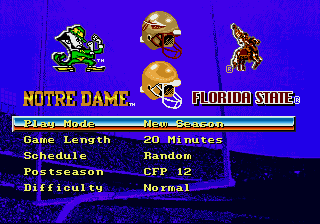

- **Conference title games** (every Postseason setting except None): the top two in each conference by conference record (then overall record, then rank) meet at the first team's home. The Independents have none.
- **Playoff formats:**

  | Postseason | Field |
  |---|---|
  | CFP 12 | The 2026 rules: the ACC, Big Ten, Big 12 and SEC champions, the best-ranked champion of the other conferences, Notre Dame if it's in the top 12, and the highest-ranked other teams. Seeded by rank; seeds 1-4 get a bye, first-round games are at the higher seed. |
  | CFP 24 | The four champions above, the best-ranked champion of the other conferences, and 19 more teams by rank. |
  | CFP 4 | The top 4 in the rankings: semifinals 1 vs 4 and 2 vs 3, then the final. |
  | BCS 2 | The top 2 in the rankings meet in the BCS National Championship. |
  | None | Regular season only. |

  Playoff and title games can't end in a tie: they go to sudden-death overtime.
- **Season screens** (Start on the Week Schedule):
  - **Week Schedule:** one week at a time. *Play Week* simulates every CPU game of the week.
  - **Team Schedules:** any team's schedule, results and OFF/DEF ratings. C sets all of its games to HOLD (you play them) or CPU and makes it one of your teams, so its postseason games start on HOLD.
  - **Rankings:** the Top 25 and every conference's standings.
  - **CFP Bracket**, during the playoff.
  - **Season Stats, Team Stats and Team Rosters** over all 138 teams.

  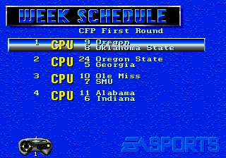 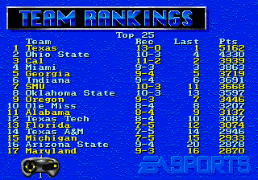
  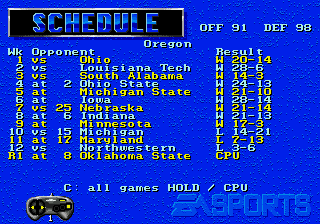 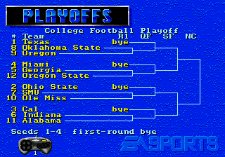

- If one of your teams wins the national title, the end-of-season celebration plays.

#### Saves

A 138-team season needs 32 KB of save RAM (the original game has 8 KB). It works in RetroArch (Genesis Plus GX) and on a Mega Everdrive Pro. Seasons saved with the v1.1.0 2026 Season Edition don't carry over: start a new season.

### Plays (Elevated)

- **67 offensive plays from College Football USA '97**, added as new rows on the existing formation pages, with play art. The CPU calls them too. A few share a name, one to each side, as they do in CF97 (for example two I-FORM HB SWEEPs).
- **Two new Shotgun plays:**
  - **RPO**: press B within about a second of the snap to pitch to the HB. Otherwise the QB keeps it and rolls out right, and you pass as usual. The CPU pitches half the time.
  - **HB SWING** (replaces HB SHOV.PASS): the HB swings across in front of the QB and up the sideline.

  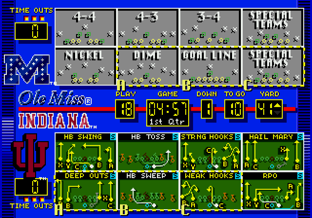

- **Flip Play.** A FLIP PLAY tile replaces Instant Replay on the play-call screen. It mirrors the formation, every assignment and the play diagrams.

  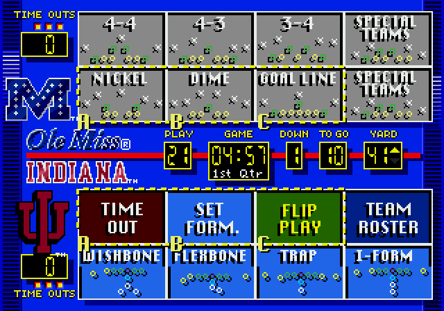

- **Pre-snap motion.** Send a back or receiver in motion before the snap: toward the middle he crosses the formation, toward the sideline he takes a short motion, and you can bring him back. Your selected defender follows him until you move the defender yourself, and CPU defenders in man coverage go with him.

  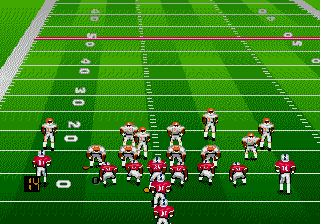

- **Line motion.** The end man on the line (a tight end or split end) can go in motion too, when a receiver off the line on his side can step up: he leaves the line and the receiver steps up to take his place.

### 6-button gamepad (Elevated)

These need a 6-button gamepad. With a 3-button gamepad the game plays as before.

- **5-receiver XY passing.** X and Y throw to the 4th and 5th receivers, with their own icons. A/B/C work as before.

  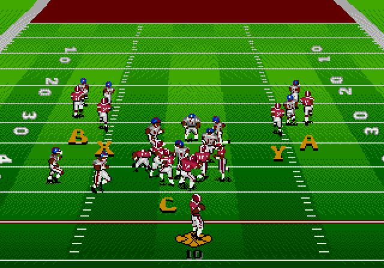

- **Flip at the line.** Open the audible menu with A, then press X: the play flips and the players run to their mirrored spots. A CPU defense usually flips with you (see [CPU and difficulty](#cpu-and-difficulty-elevated)).

  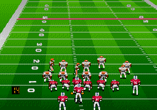

- **Defensive shifts.** Before the snap, tap X, Z or Y to pick the line, the linebackers or the safeties (Shift Line, Shift LBs, Shift Safeties shows at the top right). Then left or right shifts the group a step that way (up to 2), down and up pinch or spread the line and linebackers or move the safeties up or back, and the same button again puts them back where the call lines them up. The players sidestep into place, facing the line.

  

- **Flip your defense.** On defense, A then X mirrors your alignment and assignments; again to flip back.
- **SET FORM.** Y on the play-call screen goes back to the formations, on offense and defense.
- **Pre-snap info**, while you hold the button before the snap:
  - **Y on offense:** the called play's art, and an icon with the jersey number over each receiver.

    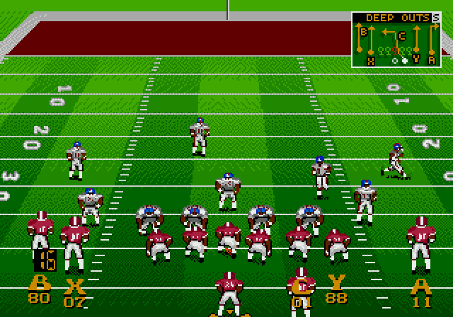

  - **Y on defense:** the defensive call's art, and a marker over each defender: R (rush), Z (zone), M (man) or S (spy).

    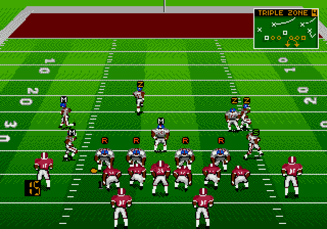

  - **Z:** energy bars over every player.

    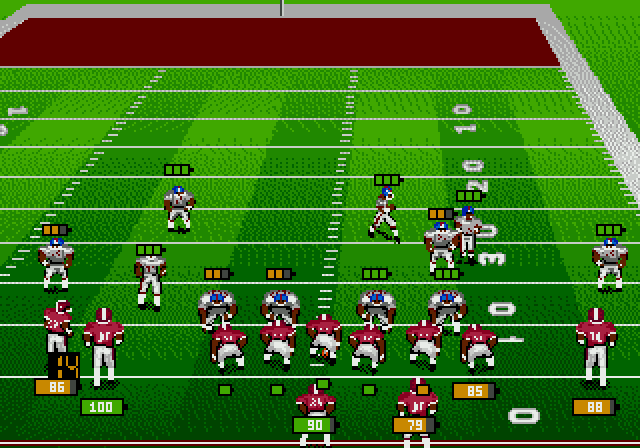

### CPU and difficulty (Elevated)

- **Difficulty row on Game Setup:**

  | Level | CPU |
  |---|---|
  | Normal | The original game. |
  | Smart | Audibles against your formation at the line and leans toward stopping what's working for you. |
  | Elite | Smart, plus +1 to the CPU team's ratings. |
  | Champion | Smart play calling with sharper adjustments and more audibles, +2 to the CPU team's ratings (speed +1), faster-reacting defenders, and a CPU team that tires at half the rate. |

- **Audibles that are harder to read** (Smart and up). Against your Nickel or Dime the CPU offense usually audibles to a run, but sometimes to another pass; against your 4-4 or Goal Line it's the other way around. Now and then it also checks into another play of the same kind elsewhere on the field. Champion audibles more often.
- **The defense answers your flip.** When you flip a play, with the FLIP PLAY tile or at the line, a CPU defense mirrors its alignment 9 times in 10, and its assignments follow: zones and rush lanes switch sides, and man defenders pick up the player who now has their man's role. It's set again in about a second.
- **Smarter 4th downs.** The CPU goes for it on 4th and short and more often in your territory, instead of almost always kicking. It still plays it safe late in a half and when leading late.
- **Reworked CPU defenses.** 3-4, 4-3 and Multiple styles, Dime on 3rd and 11+, and some 4-4 in run situations. Nickel and Dime linebackers are picked by rating, and every team uses the same DT1/DT2 and MLB1/MLB2 roster layout.
- **The CPU runs VEER** with its Option and Power offense styles. The original game never called VEER plays.
- **Team OFF/DEF ratings on Game Setup**, under each team's logo, as modern-style overall ratings (OVR). In the Elevated edition they come from EA's original team ratings; in the 2026 Season Edition from the 2026 rosters.

  

### Quality of life (Elevated)

- **Faster kickoff setup.** After a score the players run to their kickoff spots much faster: about 5 seconds to the kick instead of 13.
- **Menu music off or on.** Press X on a 6-button gamepad on the title screen, Game Setup or the season screens to turn the menu music off, and again to turn it back on. Fight songs and sound effects still play. The music is on again after a reset or power-off.

### Title screen (Elevated)

ELEVATED appears in red under '95, so you can tell the patched game from the original at a glance (plus "2026 Season Ed." in the 2026 Season Edition). The three other patches keep the original title screen. Every patched ROM has the game's built-in checksum corrected, so none needs a Game Genie master code.

### Known limitations

- 2026 Season Edition: each team plays one of the original game's 36 fight songs, so most teams don't play their own.
- Played regular-season and exhibition games can still end in a tie, as in the original game.

## Controls

| When | Button | What it does |
|---|---|---|
| Title screen, Game Setup, season screens | X (6-button) | Menu music off / on |
| Game Setup | Left/Right on the Difficulty row | Normal, Smart, Elite, Champion |
| Play-call screen | C on the FLIP PLAY tile | Flip the play (the tile turns yellow); again to unflip |
| | Y (6-button) | SET FORM: back to the formations |
| Before the snap, offense | Up/Down | Pick a motion man (a marker with arrows shows under him) |
| | Left/Right | Send him in motion; press the other way to bring him back |
| | A, then X (6-button) | Flip the play at the line |
| | Hold Y (6-button) | Play art and receiver numbers |
| Before the snap, defense | Tap X, Z or Y (6-button) | Pick a shift: line, linebackers or safeties |
| | Then Left/Right | Shift the group a step that way (up to 2) |
| | Then Down/Up | Line and linebackers: pinch / spread. Safeties: step up / back |
| | The same button again | Back to the call's alignment |
| | A, then X (6-button) | Flip your alignment; again to flip back |
| | Hold Y (6-button) | Defensive call art and assignments |
| Before the snap, either side | Hold Z (6-button) | Energy bars |
| After the snap, QB | C, then A/B/C | Pass to receivers 1-3, as in the original game |
| | C, then X/Y (6-button) | Pass to receivers 4-5 |
| RPO play | B within about 1 second of the snap | Pitch to the HB |
| Team Schedules (2026) | C | All of the team's games to HOLD or CPU |

**6-button gamepad in RetroArch (Genesis Plus GX):** the patched ROMs tell the emulator they support 6-button gamepads. If X, Y and Z do nothing, set *Quick Menu → Controls → Port 1 Controls → Device Type* to *MD Joypad 6 Button*.

## How to patch

1. Get an unmodified USA ROM that matches the checksums under [Original ROM required](#original-rom-required).
2. Download one `.bps` patch from the [`patches`](patches) folder and apply it. **Pick just one of these options** (any BPS patcher works):
   - **[Rom Patcher JS](https://www.marcrobledo.com/RomPatcher.js/)**, in your browser: choose your ROM, choose the patch, click *Apply patch*, save the result.
   - **Or [Floating IPS (Flips)](https://github.com/Alcaro/Flips)**: *Apply Patch*, pick the patch, pick your ROM, save.
   - **Or RetroArch soft-patching** (Genesis Plus GX core), no patched file needed: put the `.bps` next to your unzipped ROM and rename it to the same name as the ROM, e.g. `Bill Walsh College Football 95 (USA).md` + `Bill Walsh College Football 95 (USA).bps`. RetroArch applies it when the game loads and your ROM file stays unchanged.
3. Always patch the original ROM, not an already patched one. The patcher checks your ROM and refuses a different version.

## Game Genie codes (fatigue only, no patching)

If you only want to remove or fix fatigue, you can use Game Genie codes on the original ROM instead of patching it.

- These are v1.0's fatigue codes: the fixed version halves the original drain per play and recovers 4x faster. They don't include the current fatigue system or the other fixes; for those, use a patch.
- The first code in each line, `RZWB-66VG`, is the master code. It skips the game's checksum check, and the game won't start without it.
- Use them on the unpatched ROM only.

**No fatigue** (2 codes):
```
RZWB-66VG+R17A-N6YY
```

**Fixed fatigue** (5 codes), v1.0's fatigue fix:
```
RZWB-66VG+BD7A-NF66+FS7A-NYY8+AD7A-NY7C+JD7T-NH7C
```

- **In RetroArch:** go to *Quick Menu → Cheats*, add a new cheat, paste the whole line (codes joined with `+`) as its code, then enable it and apply the changes.
- **On a real Game Genie:** both lines fit (it holds 5 codes).

## Original ROM required

| | |
|---|---|
| File | `Bill Walsh College Football 95 (USA).md` (No-Intro name; `.bin`/`.gen` are fine too) |
| Size | 2,097,152 bytes (no header) |
| CRC32 | `A582F45A` |
| SHA-1 | `2ae000f45474b3cdedd08eeca7f5e195959ba689` |
| SHA-256 | `81a62d8ac659b1be6572220da7722ff73a55802407742d8e6fef3bcc873b9c20` |

## Patched ROMs

| Patch | Size | CRC32 | SHA-1 | Genesis header checksum |
|---|---|---|---|---|
| Elevated | 2,097,152 bytes | `D2B7B8B1` | `dcbfd7c650078e69ad6f899eaa0ef82764f413bc` | `128C` |
| Elevated: 2026 Season Edition | 4,194,304 bytes | `BAE6B048` | `1d75b32792b3cdc4266c3480419bb720755856c4` | `4802` |
| Fixed Fatigue + Fixes | 2,097,152 bytes | `D7DA052E` | `c0997d06f32faa96d553862561550e51bbde8cec` | `EA9C` |
| Fixed Fatigue | 2,097,152 bytes | `FB633059` | `433ee808e77dc4254ac520682bad9e647584ae92` | `76E7` |
| No Fatigue | 2,097,152 bytes | `46E349F8` | `8ce1c5e64ee7cad54cac5df76470fe1ae994698c` | `B11D` |

Patch files:

| File | Size | SHA-256 |
|---|---|---|
| `Bill_Walsh_College_Football_95_Elevated_v2_0_0.bps` | 136,764 bytes | `107772c3c1ec9453e7e5957afbfc969c00a4f6a3a205b909aed080ca514fe911` |
| `Bill_Walsh_College_Football_95_Elevated_2026_Season_v2_0_0.bps` | 407,578 bytes | `2558f4eb06443b4c954c8eaf83aed8e15646659e9d2389b860ee30288e3794b2` |
| `Bill_Walsh_College_Football_95_Fixed_Fatigue_Fixes_v2_0_0.bps` | 632 bytes | `20b0c5d526666bb9a0aa27f8e0ed5468446be6e1b1d2f6d4de697a214904a996` |
| `Bill_Walsh_College_Football_95_Fixed_Fatigue_v2_0_0.bps` | 331 bytes | `73c28af91eec51b98300e95651a7f7695a675054f3b6dc3e21260dcff8f8249b` |
| `Bill_Walsh_College_Football_95_No_Fatigue_v2_0_0.bps` | 44 bytes | `9005796a80bf7c397f2039b6386454ef7b37c0570c2dc5bda33282964b452d73` |

## Changelog

### v2.0.0 (2026-11-11)
- **2026 Season Edition, rebuilt:** all 138 FBS teams (28 with new art), the 2026 conferences, rosters from CFB 27's ratings (Week 9 update), team styles and Walsh Reports for every team. New season mode: random or real 2026 schedules, conference title games, CFP 12, CFP 24, CFP 4, BCS 2 or no postseason, a CFP Bracket screen, Team Schedules for any team, Rankings with every conference, and Season Stats over all 138 teams. 4 MB ROM with 32 KB of save RAM (seasons saved with v1.1.0 start over). The pause menu shows the timeouts left, and single-digit jersey numbers have no leading zero.
- **Both Elevated editions:** defensive shifts and defense flips at the line (6-button), a CPU defense that answers your flip, line motion, SET FORM with Y on the play-call screen, faster kickoff setups, harder-to-read CPU audibles, and the menu music off or on with X.
- **Pitches to fast backs** are re-aimed in flight (Elevated editions and Fixed Fatigue + Fixes).
- **Fixed Fatigue + Fixes** now has only fixes for the original game's bugs: it also gets the season-sim fix, and the run-speed change for more explosive plays is now in the Elevated editions only.
- Fixes for v1.1.0 bugs: a delay of game or timeout after a flip at the line left the next play flipped; with the ball on the far hash, a CPU man defender could run across the field when your receiver went in motion.
- Fixed Fatigue and No Fatigue are the same as in v1.1.0.

### v1.1.0 (2026-11-09)
- The mod is now called Elevated; two editions (Elevated, and Elevated: 2026 Season Edition) plus three smaller patches (Fixed Fatigue + Fixes, Fixed Fatigue, No Fatigue).
- New fatigue system: every player tires from what he does on the field and recovers at each snap.
- 67 offensive plays from College Football USA '97, a new RPO play and HB SWING; the CPU calls the new plays.
- Flip Play, pre-snap motion.
- 6-button gamepad: 5-receiver passing, flip at the line, pre-snap info (Y) and energy (Z).
- Difficulty levels (Normal, Smart, Elite, Champion), smarter 4th downs, reworked CPU defenses, VEER for the CPU.
- Season-sim fix (offense and defense ratings were read backwards) and team OFF/DEF ratings on Game Setup.
- 2026 Season Edition: 11 teams from CF97, 2026 conferences, 2026 rosters from CFB 27 ratings, team styles, new Walsh Reports, CF97 logos for every team, new title art.
- Title screen: ELEVATED.
- The patches moved to the `patches` folder.

### v1.0 (2026-11-06), first release
- Released as *Bill Walsh College Football '95 Rebalanced*.
- Fatigue fix in two versions (fixed, none).
- Reduced slowdown on long runs and runs after the catch (human and CPU teams): 1.5-second burst, then a fade that depends on the runner's energy.
- 2-point conversion turnover kickoff fix.
- Title screen: REBALANCED under '95; the logo moved up 16 pixels to make room.
- Game Genie codes for the fatigue fix (fatigue only).

### Betas
The `v5` patches that were here before v1.0 were betas. They play the same as v1.0 but have the original title screen. The betas, release candidates and test builds of v1.1.0 and v2.0.0 were private.

## Technical notes

For anyone digging into the ROM (68000 addresses):

- **Fatigue**:
  - Drain while the play is live: a hook at the snap (`0x06D11E`) and one in the per-frame player loop (`0x067E60`) add fatigue for each player from his speed every frame, his time in blocks, and the game's own events (tackles, route ends, jukes) at a quarter of their original cost.
  - Recovery: at each snap every player recovers a quarter of his fatigue; the roster screen no longer adds recovery. Code at `0x1E81E0`.
  - No Fatigue: AddFatigue returns at once (`0x06FA94` → `rts`).
- **More explosive plays** (Elevated editions):
  - In the original, a random tick at `0x075EC0` costs the ball carrier 1 speed point plus 10 fatigue while his speed is above 6.
  - The tick is hooked at `0x075EDE`. A snap hook at `0x06FB50` stores the original-game speed in two unused bytes of the player object (`$7E/$7F`), so fatigue builds exactly as before while the actual speed loss follows the table above.
  - Code at `0x1F0100`.
- **2-point fix**:
  - The fumble-recovery code (`0x075AA8`) flips possession even on a try; the interception path already checks for tries.
  - Hooks at `0x06FC38`, `0x06E588` and `0x06E4EC` (code at `0x1F0240`) count possession flips during the try and give the ball back to the scoring team before the kickoff is set up.
- **Pitches**: the hand-off/pitch routine (`0x075128`) leads a toss by the target's velocity at the pitch. A hook at `0x075230` marks the toss, and one in the ball's flight step (`0x07322A`) re-aims it every frame at the target's position plus his current velocity × the frames left, keeping the flight time. In Fixed Fatigue + Fixes the code is at `0x1E6800`.
- **Plays**: the new plays are numbers 100-167 in a new play list (`lea` at `0x06DC86`); a new offense image list holds the added rows, and the play-call menu maps each box to its play number. The CPU's play categories (pick at `0x079AB0`, membership test at `0x079A54`) point to a copy with the new plays, keeping each situation's run/pass and formation mix. The RPO and HB SWING take plays 143 (was DEEP OUTS 2) and 64 (was HB SHOV.PASS); the pitch is read in the ball carrier's input handler (`0x071AB4`).
- **Flip Play**: the top-row action that was Instant Replay (`0x06D930`) toggles the flip; formations and play commands are mirrored when they load, and the play-call art is drawn mirrored (draw hook `0x06DB00`).
- **6-button gamepad**: the header's I/O support is `J6` (`0x190`), and the pad read (`0x07A812`) reads both ports as 6-button pads; X/Y go into the throw select (`0x071CE4`) and a 5-receiver list.
- **Pre-snap shifts, defense flips, line motion**: input hook at `0x07601E`, SET FORM in the play-call menu handler (`0x06D79C`). The game's walk command moves the players; its start (`0x0734FE`) is hooked to speed up sidesteps, the realignment after a flip (3×) and the kickoff setup (3×), with every speed capped at ±32767. During a flip the defense's call is a mirrored copy in RAM; man defenders aim at their man's final spot through a hook in the hold handler (`0x0733D2`).
- **CPU**: the offense rule set (4th downs) is a copy at `0x106E7A`; the difficulty levels add a Game Setup row (menu at `0x10E000`, code from `0x10E6C0`), CPU rating boosts at the snap, and their own play-calling rule sets. The audible rules for Smart/Elite and Champion are at `0x1E9920` (Elevated) and `0x290000` (2026 Season Edition).
- **Menu music**: hooks at the sound driver's request (`0x07A6BC`) and stop (`0x07A654`) entries and at its update in the vblank handler (`0x076FE4`); only the menu songs `0x41` and `0x42` are affected.
- **Season sim**: `0x06F1A8` `move.w $2(a1),d1 ; move.w $4(a1),d2` → `move.w $4(a1),d1 ; move.w $2(a1),d2`, so a team scores by its offense (+2 of its ratings group) against the opponent's defense (+4).
- **OFF/DEF on Game Setup**: hook `0x0783A0` (code at `0x10E900`) draws the text under each logo. The shown OVRs come from a table at `0x10DFB0` ("OVR1", then 36 × {OFF, DEF} bytes by team slot; `0x218000` and 138 teams in the 2026 Season Edition); the sim reads the 0-100 ratings words.
- **2026 Season Edition**: a 4 MB ROM. Team tables from `0x218000` (OVRs, styles, menu order, end zones, fight songs, Walsh Report pointers), the Walsh Report text from `0x219000`, team data blocks from `0x230000`. 32 KB of save RAM on odd bytes (`0x200001`-`0x20FFFF`): only small copy routines below 2 MB switch it on, and the season screens work on a copy in RAM.
- **Title screen**: the title image (`0x17C114`) is copied to `0x1F1000`, with the logo moved up and ELEVATED drawn in; the title code's two references to it (`0x078D70`, `0x078DA0`) point to the copy. In the 2026 Season Edition the portrait's cells and palette line 0 hold the new art.
- **Checksum**: the EA checksum constant at `0x1E6430` and the Sega header checksum are recomputed.

## Testing

- Play-tested in RetroArch (Genesis Plus GX) and on real hardware (Mega Everdrive Pro), where a 2026 season saved and reloaded fine.
- Verified with scripted headless runs (Genesis Plus GX):
  - Each patch applied to the original ROM reproduces the ROM above byte for byte (with Flips, and with a separate BPS decoder).
  - Every patched ROM boots, shows its title screen and plays CPU vs CPU.
  - Full 2026 seasons from a new season to the champion, every game simulated, in every Postseason setting with random and real schedules: every game played; title games, seeds, pairings and the bracket checked at each round.
  - Pre-snap: 240 plays with random flips at the line, motions (line motion included), defense flips and shifts: every play snapped and ran with nobody off the field, except a few CPU delays of game.
  - Pitches: 46 pitches on 14 option and toss plays with max-speed backs, all caught. The case that fails in the original game (a long pitch after the QB has run) is caught.
  - Audibles: 12 tries of a CPU pass call against a human Nickel at Champion: 5 audibles to a run, 5 to another pass, 2 none (v1.1.0: 11 runs).
  - Flip Play: the lineups and assignments of all 96 original offensive plays mirror exactly, for both teams; audibles and special teams behave.
  - Every one of the 168 plays can be picked on the play-call screen; the RPO pitch was caught on 24 of 24 tries across defenses.
  - Difficulty: the CPU team's ratings at the snap are exactly +1 (Elite) or +2/+1 (Champion), capped at the maximum; the human team is unchanged.
  - Fatigue numbers are measured from CPU-vs-CPU games.
  - All new code is scanned for word or long accesses to odd addresses, which crash a real Genesis but not the test emulator.
- Limits:
  - The 2-point fix was verified by triggering the game's own turnover routine during conversion tries, not with a recorded real fumble.
  - In the 1994 Elevated edition and Fixed Fatigue + Fixes, the season-sim fix was checked in the code (the routine is only used by the sim).

## Credits

Created by JD637. Patches made with Floating IPS.

- Added plays, and 110 of the 2026 Season Edition's teams, come from EA's College Football USA '97.
- Helmets, logos, wordmarks and uniforms for the other 28 teams were made for this mod.
- 2026 Season Edition rosters are converted from EA Sports College Football 27's player ratings.
- The real 2026 schedule comes from [cfbfastR-data](https://github.com/sportsdataverse/cfbfastR-data) (teams, dates and home/away only).
- 2026 Season Edition title art: Malachi Toney, converted to pixel art from a photo used with permission.

Not affiliated with or endorsed by Electronic Arts, the NCAA, or any school or player. No ROM is included in this repository.
