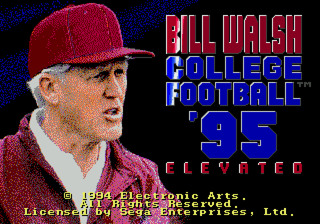
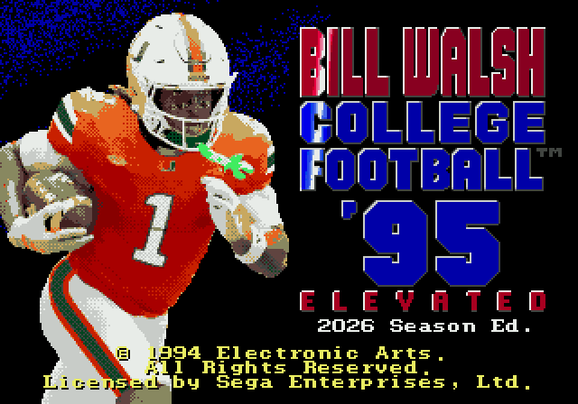
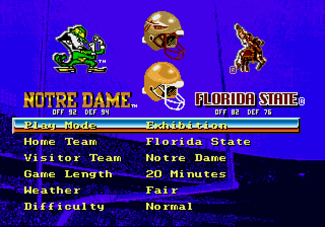

# Bill Walsh College Football '95 Elevated

A gameplay mod for **Bill Walsh College Football '95** (Sega Genesis / Mega Drive, USA). It fixes the broken fatigue system, cuts the slowdown on long runs, adds 67 plays from College Football USA '97 plus new RPO and HB SWING plays, flip plays and pre-snap motion, gives the CPU smarter play calling and four difficulty levels, and adds 6-button gamepad controls. The **2026 Season Edition** also brings the 2026 teams, conferences and rosters.

This repository contains BPS patches only, no ROM. You need your own copy of the game.

The mod was first released as *Bill Walsh College Football '95 Rebalanced* (v1.0). The v1.0 patches are still attached to the [v1.0 release](https://github.com/jd6-37/Bill-Walsh-CFB-95-Elevated/releases/tag/v1.0).

 

## Contents

- [Why Bill Walsh '95?](#why-bill-walsh-95)
- [Which patch?](#which-patch)
- [Features](#features)
- [Controls](#controls)
- [How to patch](#how-to-patch)
- [Game Genie codes (fatigue only, no patching)](#game-genie-codes-fatigue-only-no-patching)
- [Original ROM required](#original-rom-required)
- [Patched ROMs](#patched-roms)
- [Changelog](#changelog)
- [Technical notes](#technical-notes)
- [Testing](#testing)
- [Credits](#credits)

## Why Bill Walsh '95?

In my opinion, Bill Walsh College Football '95 for the Sega Genesis has the greatest gameplay of any 16-bit football game. It has the fun physics and player models of Madden '94, and it introduced windowless passing for the first time in an EA Sports football game. Later games (Madden '95 and College Football USA '96) changed the player models and gameplay significantly and, in my opinion, aren't as fun to play. The biggest problem with BW95 was its broken fatigue system, which this mod fixes. Since v1.1 it also adds the plays, controls and CPU smarts the game was missing.

## Which patch?

| Patch | What you get |
|---|---|
| `Bill_Walsh_College_Football_95_Elevated_v1_1_0.bps` | **Elevated.** Every feature below, with the original 36 teams and their 1994 rosters. Title screen: ELEVATED. |
| `Bill_Walsh_College_Football_95_Elevated_2026_Season_v1_1_0.bps` | **Elevated: 2026 Season Edition.** Every feature below, plus the 2026 teams, conferences and rosters. Title screen: ELEVATED, 2026 Season Ed. |
| `Bill_Walsh_College_Football_95_Fixed_Fatigue_Fixes_v1_1_0.bps` | The fatigue fix, more explosive plays and the 2-point conversion fix (what v1.0 had, with the new fatigue system). Original title screen. |
| `Bill_Walsh_College_Football_95_Fixed_Fatigue_v1_1_0.bps` | Only the fatigue fix. Original title screen. |
| `Bill_Walsh_College_Football_95_No_Fatigue_v1_1_0.bps` | Only one change: energy never drops. Original title screen. |

The patches are in the [`patches`](patches) folder. Both Elevated editions use Fixed Fatigue. The [Genesis CFB Toolkit](https://genesis-cfb-toolkit.vercel.app) reads the list of patches from this repo (`patches.json`).

## Features

### Fatigue (every patch except No Fatigue)

- **Everyone tires, from what he does on the field.** In the original game a running back loses about 27% energy per carry and barely recovers during a drive; only a timeout brings players back. v1.0 halved that, but only ball carriers really tired. Now every player's energy drops with what he does while the play is live: the distance he runs, the time he's locked in a block, and hits. Everyone recovers a quarter of his fatigue at each snap, and timeouts and halftime still reset everyone to 100%.
- In CPU-vs-CPU test games most players stayed between 92% and 97% through a drive, the lowest seen was 76%, and a running back was at about 90% after one carry and 86% after two straight carries.

### Gameplay fixes (Elevated and Fixed Fatigue + Fixes)

- **More explosive plays.** In the original game a ball carrier starts losing speed right away and is down to lineman speed after a few seconds, so breakaway runs crawl after a few yards. The slowdown on long runs and runs after the catch is now reduced. This applies to human- and CPU-controlled teams. The ball carrier keeps full speed for about the first 1.5 seconds, then slows down, faster the more tired he is:

  | Energy (roster screen) | Slowdown after the first 1.5 s |
  |---|---|
  | 90% or higher | about 2/3 as fast as the original game |
  | 75–89% | about 3/4 as fast as the original game |
  | below 75% | same as the original game |

- **2-point conversion bug fix.** In the original game, if the defense recovered a fumble on a conversion try, the team that got scored on had to kick off. Now the scoring team kicks off.

### Plays (Elevated)

- **67 offensive plays from College Football USA '97**, added as new rows on the existing formation pages, with play art. The CPU calls them too. A few share a name, one to each side, as they do in CF97 (for example two I-FORM HB SWEEPs).
- **Two new Shotgun plays:**
  - **RPO**: press B within about a second of the snap to pitch to the HB. Otherwise the QB keeps it and rolls out right, and you pass as usual. The CPU pitches half the time.
  - **HB SWING** (replaces HB SHOV.PASS): the HB swings across in front of the QB and up the sideline.
- **Flip Play.** A FLIP PLAY tile replaces Instant Replay on the play-call screen. It mirrors the formation, every assignment and the play diagrams.
- **Pre-snap motion.** Send a back or receiver in motion before the snap: toward the middle he crosses the formation, toward the sideline he takes a short motion, and you can bring him back. Your selected defender follows him until you move the defender yourself, and CPU defenders in man coverage go with him.

### 6-button gamepad (Elevated)

These need a 6-button gamepad. With a 3-button gamepad the game plays exactly as before.

- **5-receiver passing.** X and Y throw to the 4th and 5th receivers, with their own icons. A/B/C work as before.
- **Flip at the line.** Open the audible menu with A, then press X: the play flips and the players run to their mirrored spots.
- **Pre-snap info**, while you hold the button before the snap:
  - **Y on offense:** the called play's art, and an icon with the jersey number over each receiver.
  - **Y on defense:** the defensive call's art, and a marker over each defender: R (rush), Z (zone), M (man) or S (spy).
  - **Z:** energy bars over every player.

### CPU and difficulty (Elevated)

- **Difficulty row on Game Setup:**

  | Level | CPU |
  |---|---|
  | Normal | The original game. |
  | Smart | Audibles against your formation at the line and leans toward stopping what's working for you. |
  | Elite | Smart, plus +1 to the CPU team's ratings. |
  | Champion | Smart play calling with sharper adjustments, +2 to the CPU team's ratings (speed +1), faster-reacting defenders, and a CPU team that tires at half the rate. |

- **Smarter 4th downs.** The CPU goes for it on 4th and short and more often in your territory, instead of almost always kicking. It still plays it safe late in a half and when leading late.
- **Reworked CPU defenses.** 3-4, 4-3 and Multiple styles, Dime on 3rd and 11+, and some 4-4 in run situations. Nickel and Dime linebackers are picked by rating, and every team uses the same DT1/DT2 and MLB1/MLB2 roster layout.
- **The CPU runs VEER** with its Option and Power offense styles. The original game never called VEER plays.

### Season (Elevated)

- **Season-sim fix.** When the original game simulated CPU-vs-CPU season games, it read each team's offense and defense ratings backwards, so a great defense scored points and a great offense kept the other team's score down. Fixed.
- **Team OFF/DEF ratings on Game Setup**, under each team's logo, as modern-style overall ratings (OVR). In the Elevated edition they come from EA's original team ratings; in the 2026 Season Edition from the 2026 rosters.



### 2026 Season Edition only

- **11 teams from College Football USA '97:** Kentucky, Indiana, Iowa, UCLA, Utah, Houston, Texas Tech, Oklahoma State, Wake Forest, Ole Miss and Oregon, in place of Pitt, Army, Kansas State, Wisconsin, Arizona, California, Stanford, Washington State, Boston College, Virginia and West Virginia.
- **2026 conferences**, renamed SEC (11 teams), Big Ten (10), Big 12 (7, with Air Force) and ACC (8, with Notre Dame and Navy). Season schedules are random.
- **2026 rosters**, converted from EA Sports College Football 27's player ratings (Week 9 update).
- **CPU offense and defense styles** that follow each team's 2026 scheme.
- **Team ratings from the 2026 rosters**, for the OVRs on Game Setup and the season sim.
- **College Football USA '97 logos for every team**, so all logos on Game Setup are the same size. Swapped-in teams get their own home weather.
- **New title art:** Malachi Toney of Miami in the 2026 home uniform replaces Bill Walsh's portrait.

### Title screen (Elevated)

ELEVATED appears in red under '95, so you can tell the patched game from the original at a glance (plus "2026 Season Ed." in the 2026 Season Edition). The three other patches keep the original title screen. Every patched ROM has the game's built-in checksum corrected, so none needs a Game Genie master code.

### Known limitations

- Swapped-in teams still play the fight song of the team they replaced.
- If you swap teams in the Elevated edition with the Genesis CFB Toolkit, Game Setup still shows the OVRs of the teams that were replaced, and the season sim uses their ratings.

## Controls

| When | Button | What it does |
|---|---|---|
| Game Setup | Left/Right on the Difficulty row | Normal, Smart, Elite, Champion |
| Play-call screen | C on the FLIP PLAY tile | Flip the play (the tile turns yellow); again to unflip |
| Before the snap, offense | Up/Down | Pick a motion man (a marker with arrows shows under him) |
| | Left/Right | Send him in motion; press the other way to bring him back |
| | A, then X (6-button) | Flip the play at the line |
| | Hold Y (6-button) | Play art and receiver numbers |
| Before the snap, defense | Hold Y (6-button) | Defensive call art and assignments |
| Before the snap, either side | Hold Z (6-button) | Energy bars |
| After the snap, QB | C, then A/B/C | Pass to receivers 1-3, as in the original game |
| | C, then X/Y (6-button) | Pass to receivers 4-5 |
| RPO play | B within about 1 second of the snap | Pitch to the HB |

**6-button gamepad in RetroArch (Genesis Plus GX):** the patched ROMs tell the emulator they support 6-button gamepads. If X, Y and Z do nothing, set *Quick Menu → Controls → Port 1 Controls → Device Type* to *MD Joypad 6 Button*.

## How to patch

1. Get an unmodified USA ROM that matches the checksums under [Original ROM required](#original-rom-required).
2. Download one `.bps` patch from the [`patches`](patches) folder and apply it. **Pick just one of these options** (any BPS patcher works):
   - **[Rom Patcher JS](https://www.marcrobledo.com/RomPatcher.js/)**, in your browser: choose your ROM, choose the patch, click *Apply patch*, save the result.
   - **Or [Floating IPS (Flips)](https://github.com/Alcaro/Flips)**: *Apply Patch*, pick the patch, pick your ROM, save.
   - **Or RetroArch soft-patching** (Genesis Plus GX core), no patched file needed: put the `.bps` next to your unzipped ROM and rename it to the same name as the ROM, e.g. `Bill Walsh College Football 95 (USA).md` + `Bill Walsh College Football 95 (USA).bps`. RetroArch applies it when the game loads and your ROM file stays unchanged.
3. Always patch the original ROM, not an already patched one. The patcher checks your ROM and refuses a different version.

## Game Genie codes (fatigue only, no patching)

If you only want to remove or fix fatigue, you can use Game Genie codes on the original ROM instead of patching it.

- These are v1.0's fatigue codes: the fixed version halves the original drain per play and recovers 4x faster. They don't include v1.1's fatigue system, the explosive-plays change or the 2-point conversion fix; for those, use a patch.
- The first code in each line, `RZWB-66VG`, is the master code. It skips the game's checksum check, and the game won't start without it.
- Use them on the unpatched ROM only.

**No fatigue** (2 codes):
```
RZWB-66VG+R17A-N6YY
```

**Fixed fatigue** (5 codes), v1.0's fatigue fix:
```
RZWB-66VG+BD7A-NF66+FS7A-NYY8+AD7A-NY7C+JD7T-NH7C
```

- **In RetroArch:** go to *Quick Menu → Cheats*, add a new cheat, paste the whole line (codes joined with `+`) as its code, then enable it and apply the changes.
- **On a real Game Genie:** both lines fit (it holds 5 codes).

## Original ROM required

| | |
|---|---|
| File | `Bill Walsh College Football 95 (USA).md` (No-Intro name; `.bin`/`.gen` are fine too) |
| Size | 2,097,152 bytes (no header) |
| CRC32 | `A582F45A` |
| SHA-1 | `2ae000f45474b3cdedd08eeca7f5e195959ba689` |
| SHA-256 | `81a62d8ac659b1be6572220da7722ff73a55802407742d8e6fef3bcc873b9c20` |

## Patched ROMs

| Patch | CRC32 | SHA-1 | Genesis header checksum |
|---|---|---|---|
| Elevated | `97C351B6` | `04ea053c6c868c59991d183bef20aee81c0e0edf` | `FCFC` |
| Elevated: 2026 Season Edition | `09781B52` | `345d21044e1038bfd79b28766df7adc1a6dd71ef` | `87FE` |
| Fixed Fatigue + Fixes | `03A9F4B5` | `1ee2aeb1fd2a09080dc90e8f5728e5c9cfe03907` | `FA08` |
| Fixed Fatigue | `FB633059` | `433ee808e77dc4254ac520682bad9e647584ae92` | `76E7` |
| No Fatigue | `46E349F8` | `8ce1c5e64ee7cad54cac5df76470fe1ae994698c` | `B11D` |

Patch files:

| File | Size | SHA-256 |
|---|---|---|
| `Bill_Walsh_College_Football_95_Elevated_v1_1_0.bps` | 131,603 bytes | `f5effe877e11a83c6cf3d705f09ff4e2589c9b07715e3c832288e2e03ada8587` |
| `Bill_Walsh_College_Football_95_Elevated_2026_Season_v1_1_0.bps` | 178,500 bytes | `ff64954fbf62bc7aa099f4f8c9573ba2e1ecb4b71ccabada6d751e9a6d39312b` |
| `Bill_Walsh_College_Football_95_Fixed_Fatigue_Fixes_v1_1_0.bps` | 567 bytes | `b517a95c857d281ab872531b45a222c6cc1512c8f322671bfb4665ac9711bc8e` |
| `Bill_Walsh_College_Football_95_Fixed_Fatigue_v1_1_0.bps` | 331 bytes | `73c28af91eec51b98300e95651a7f7695a675054f3b6dc3e21260dcff8f8249b` |
| `Bill_Walsh_College_Football_95_No_Fatigue_v1_1_0.bps` | 44 bytes | `9005796a80bf7c397f2039b6386454ef7b37c0570c2dc5bda33282964b452d73` |

## Changelog

### v1.1.0 (2026-11-09)
- The mod is now called Elevated; two editions (Elevated, and Elevated: 2026 Season Edition) plus three smaller patches (Fixed Fatigue + Fixes, Fixed Fatigue, No Fatigue).
- New fatigue system: every player tires from what he does on the field and recovers at each snap.
- 67 offensive plays from College Football USA '97, a new RPO play and HB SWING; the CPU calls the new plays.
- Flip Play, pre-snap motion.
- 6-button gamepad: 5-receiver passing, flip at the line, pre-snap info (Y) and energy (Z).
- Difficulty levels (Normal, Smart, Elite, Champion), smarter 4th downs, reworked CPU defenses, VEER for the CPU.
- Season-sim fix (offense and defense ratings were read backwards) and team OFF/DEF ratings on Game Setup.
- 2026 Season Edition: 11 teams from CF97, 2026 conferences, 2026 rosters from CFB 27 ratings, team styles, CF97 logos for every team, new title art.
- Title screen: ELEVATED.
- The patches moved to the `patches` folder, with `patches.json` for the Genesis CFB Toolkit.

### v1.0 (2026-11-06), first release
- Fatigue fix in two versions (fixed, none).
- Reduced slowdown on long runs and runs after the catch (human and CPU teams): 1.5-second burst, then a fade that depends on the runner's energy.
- 2-point conversion turnover kickoff fix.
- Title screen: REBALANCED under '95; the logo moved up 16 pixels to make room.
- Game Genie codes for the fatigue fix (fatigue only).

### Betas
The `v5` patches that were here before v1.0 were betas. They play the same as v1.0 but have the original title screen. The v1.1.0 betas and release candidates were private test builds.

## Technical notes

For anyone digging into the ROM (68000 addresses):

- **Fatigue (v1.1)**:
  - Drain while the play is live: a hook at the snap (`0x06D11E`) and one in the per-frame player loop (`0x067E60`) add fatigue for each player from his speed every frame, his time in blocks, and the game's own events (tackles, route ends, jukes) at a quarter of their original cost.
  - Recovery: at each snap every player recovers a quarter of his fatigue; the roster screen no longer adds recovery. Code at `0x1E81E0`.
  - No Fatigue: AddFatigue returns at once (`0x06FA94` → `rts`).
- **Run slowdown** (as in v1.0):
  - In the original, a random tick at `0x075EC0` costs the ball carrier 1 speed point plus 10 fatigue while his speed is above 6.
  - The tick is hooked at `0x075EDE`. A snap hook at `0x06FB50` stores the original-game speed in two unused bytes of the player object (`$7E/$7F`), so fatigue builds exactly as before while the actual speed loss follows the table above.
  - Code at `0x1F0100`.
- **2-point fix** (as in v1.0):
  - The fumble-recovery code (`0x075AA8`) flips possession even on a try; the interception path already checks for tries.
  - Hooks at `0x06FC38`, `0x06E588` and `0x06E4EC` (code at `0x1F0240`) count possession flips during the try and give the ball back to the scoring team before the kickoff is set up.
- **Plays**: the new plays are numbers 100-167 in a new play list (`lea` at `0x06DC86`); a new offense image list holds the added rows, and the play-call menu maps each box to its play number. The CPU's play categories (pick at `0x079AB0`, membership test at `0x079A54`) point to a copy with the new plays, keeping each situation's run/pass and formation mix. The RPO and HB SWING take plays 143 (was DEEP OUTS 2) and 64 (was HB SHOV.PASS); the pitch is read in the ball carrier's input handler (`0x071AB4`).
- **Flip Play**: the top-row action that was Instant Replay (`0x06D930`) toggles the flip; formations and play commands are mirrored when they load, and the play-call art is drawn mirrored (draw hook `0x06DB00`).
- **6-button gamepad**: the header's I/O support is `J6` (`0x190`), and the pad read (`0x07A812`) reads both ports as 6-button pads; X/Y go into the throw select (`0x071CE4`) and a 5-receiver list.
- **CPU**: the offense rule set (4th downs) is a copy at `0x106E7A`; the difficulty levels add a Game Setup row (menu at `0x10E000`, code from `0x10E6C0`), CPU rating boosts at the snap, and their own play-calling rule sets.
- **Season sim**: `0x06F1A8` `move.w $2(a1),d1 ; move.w $4(a1),d2` → `move.w $4(a1),d1 ; move.w $2(a1),d2`, so a team scores by its offense (+2 of its ratings group) against the opponent's defense (+4).
- **OFF/DEF on Game Setup**: hook `0x0783A0` (code at `0x10E900`) draws the text under each logo. The shown OVRs come from a table at `0x10DFB0` ("OVR1", then 36 × {OFF, DEF} bytes by team slot); the sim reads the 0-100 ratings words.
- **Title screen**: the title image (`0x17C114`) is copied to `0x1F1000`, with the logo moved up and ELEVATED drawn in; the title code's two references to it (`0x078D70`, `0x078DA0`) point to the copy. In the 2026 Season Edition the portrait's cells and palette line 0 hold the new art.
- **Checksum**: the EA checksum constant at `0x1E6430` and the Sega header checksum are recomputed.
- **Patch list**: `patches.json` lists the released patches for the [Genesis CFB Toolkit](https://genesis-cfb-toolkit.vercel.app), whose Patch tab reads it and the `.bps` files straight from this repo's `main` branch. Update it with every release: the newest release goes first, with each patch's file, size, SHA-256 and the SHA-1 of the patched ROM. Older releases stay listed without a `file`, so the toolkit still recognizes their ROMs. Format: [docs/patches.md](https://github.com/jd6-37/Genesis-CFB-Toolkit/blob/main/docs/patches.md) in the toolkit's repo.

## Testing

- Play-tested in RetroArch (Genesis Plus GX core) through the v1.1.0 betas and release candidates.
- Verified with scripted headless runs (Genesis Plus GX):
  - Each patch applied to the original ROM reproduces the ROM above byte for byte (with Flips, and with a separate BPS decoder).
  - Every patched ROM boots, shows its title screen and plays CPU vs CPU.
  - Flip Play: the lineups and assignments of all 96 original offensive plays mirror exactly, for both teams; audibles and special teams behave.
  - Every one of the 168 plays can be picked on the play-call screen; the RPO pitch was caught on 24 of 24 tries across defenses.
  - Difficulty: the CPU team's ratings at the snap are exactly +1 (Elite) or +2/+1 (Champion), capped at the maximum; the human team is unchanged.
  - Fatigue numbers are measured from CPU-vs-CPU games.
- Limits:
  - The 2-point fix was verified by triggering the game's own turnover routine during conversion tries, not with a recorded real fumble.
  - A full season can't be played through in the test emulator (it has no battery save); the season-sim fix was checked in the code (the routine is only used by the sim).
  - Not tested on real hardware.

## Credits

Created by JD637. Patches made with Floating IPS.

- Added plays and the 2026 Season Edition's logos and swapped-in teams come from EA's College Football USA '97.
- 2026 Season Edition rosters are converted from EA Sports College Football 27's player ratings.
- 2026 Season Edition title art: Malachi Toney, converted to pixel art from a photo used with permission.

Not affiliated with or endorsed by Electronic Arts, the NCAA, or any school or player. No ROM is included in this repository.
